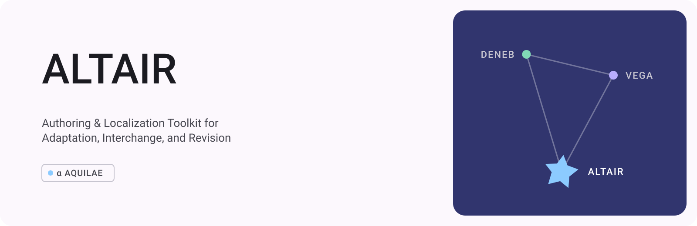

# Altair



**ALTAIR** — **A**uthoring & **L**ocalization **T**oolkit for **A**daptation, **I**nterchange, and **R**evision

Altair is a visual authoring and localization tool for visual novels. It brings
scenes, dialogue, assets, languages, preview, and story flow into one editable
workspace.

## What Altair does

- Edits dialogue and story commands with visual controls.
- Manages any number of project languages and their fonts.
- Previews the current scene with Vega while you work.
- Imports, converts, and exports projects through plugins.
- Provides asset browsing, flowcharts, history, drafts, and plugin management.

A project chooses its own languages. Source-specific language and server rules
remain in the relevant source plugin.

The preview opens the current scene before locating the selected statement.
Select the relevant branch in the player to preview a statement after a choice.
Playback from the beginning and animation audition remain available while a
statement is outside the selected branch.

Storyboard thumbnails capture the native stage after the range's first dialogue
statement or dialogue group has executed, including its nested actor and camera
commands. They use the same replay checkpoints as the player.

Imported dialogue groups show their speaker and dialogue on scene cards and in
storyboard ranges. Edit their dialogue, translations, and voice bindings directly
in the inspector; the timeline keeps each cue's identity, time, and role.

The native timeline also edits audio clips on named tracks: source trim,
duration, speed, clip and track volume, mute, loop and fades. Waveforms use the
actual project audio. Export the timeline's mix as 48 kHz stereo PCM WAV, or
download a ZIP of aligned WAV stems. These clips compile to Vega's native
`haneoka.vega-core:audioClip@1` command and remain editable after game import.

The preview's stage-video action records the same Three backend and that
player's audio bus at 720p or 1080p. Recording starts at the scene beginning;
the finish action downloads a ZIP with the video and playback-timed SRT.
The video contains the stage pixels; dialogue and other theme UI are delivered
through the subtitle sidecar. Offline deterministic takes and transparent
frame sequences require a separate export backend.

## Try it

[First Light](https://github.com/haneoka-gakuen/vega-example-first-light) is an
editable example project designed to open directly in Altair.

```sh
pnpm install --frozen-lockfile
pnpm dev
```

[Vega](https://github.com/haneoka-gakuen/vega) plays the project, and
[Deneb](https://github.com/haneoka-gakuen/deneb) builds release targets.

[Terre and Craft parity](docs/TERRE_CRAFT_PARITY.md) records implemented tools and remaining compatibility work.

## License

Altair is available under MPL-2.0. Third-party formats and components retain
their own licenses.
